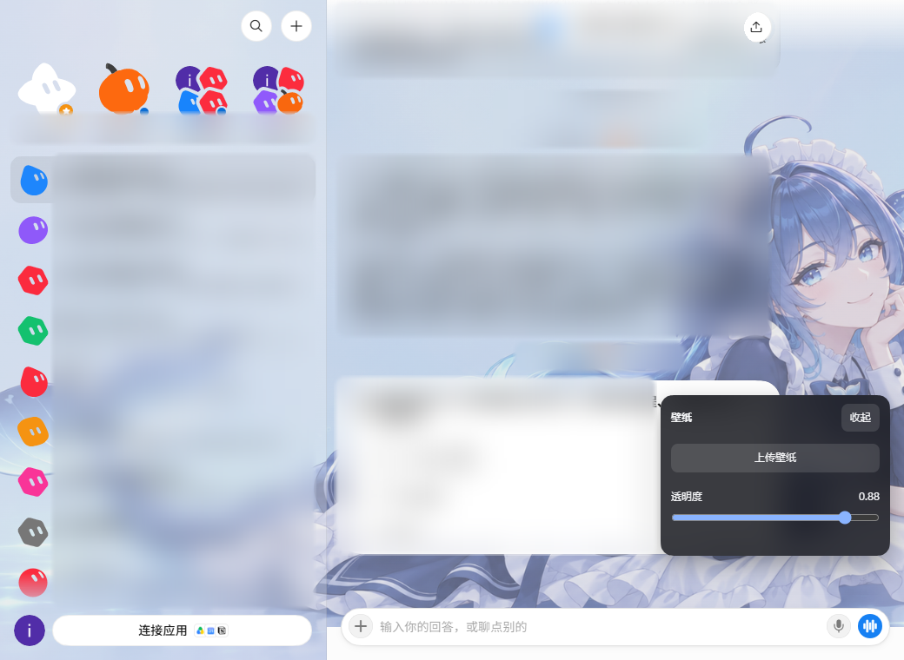

# Grok Bot 换壁纸背景（Windows 适配开源版）

每天对着 Grok Bot 默认的黑白聊天框是不是早就看腻了？

原版 `grokbot-wallpaper` 只支持 macOS，Windows 电脑直接装会报错退出。于是专门重写适配了这版 **Windows 桌面客户端可用的换壁纸 Skill**（同时兼容 macOS）——不用破解客户端、不改 `app.asar` 安装包，装好后直接在右下角点 **「上传壁纸」**，挑一张你喜欢的图就能换上！



仓库内置了一张按社区“DeepSeek娘 / 蓝色大肥鱼”二创人设生成的原创示例壁纸（[`examples/deepseek-whale-girl.png`](examples/deepseek-whale-girl.png)，1.85MB），开箱就能直接试效果。

---

## 保姆级教程：怎么安装、开启、使用与关闭（零代码版）

### 1. 怎么安装？
不需要自己打开黑框敲代码，直接把这句话发给你的 Grok Bot（Agent）：
> 「帮我安装这个 Windows 版 Grok Bot 换壁纸项目：`https://github.com/1806629231-del/grokbot-wallpaper-windows`」

Bot 会自动把技能拉到本机准备好，全程不会修改官方的 `Grok Bot.exe` 或内部打包文件。

---

### 2. 怎么开启？（分首次开启 & 日常重开）

- **第一次开启**：
  安装完后，对你的 Bot 说：**「帮我开启壁纸面板（可以先换上自带的大肥鱼示例图）」**。
  - 因为第一次开启需要在你本机 `127.0.0.1` 接通本地窗口连接，Bot 会先礼貌提示你确认当前对话已保存，然后帮你**重开一次 Grok Bot 窗口**。
  - 窗口重开后，右下角就会浮出一个深色的 **「壁纸」** 控制面板！
- **日常重新开启（关掉软件再打开后）**：
  - 如果你之前把 Grok Bot 彻底退出了，下次再打开软件想挂回壁纸时，直接对 Bot 说一句：**「帮我把壁纸挂出来」**，它就会自动读取你上次挑好的图片和透明度重新挂上。

---

### 3. 怎么使用？（换喜欢的图 · 调透明度 · 收起防挡字）

1. **换上你喜欢的图**：点击右下角面板里的 **「上传壁纸」** 按钮，从电脑文件夹里随便挑一张你喜欢的图（支持 `PNG / JPG / WEBP`，单张不超过 `4MB`），点确定就会秒换上，**不需要重启窗口**。
2. **调整透明度**：左右拖动面板上的 **「透明度」** 滑条实时预览（范围 `0.15`–`1.00`）。实测深色保护模式下调到 **`0.88`** 最舒服——平时看聊天文字清清楚楚，底下又能透出壁纸轮廓。
3. **挪位置或收起面板**：如果觉得面板挡视线，按住面板顶部标题栏可以**随意拖到屏幕任何角落**；也可以点面板右上角的 **「收起」** 按钮，它会缩成一个小小的「壁纸」胶囊（壁纸本身继续保留），想换图时再点开即可。

---

### 4. 怎么关闭与恢复默认黑白界面？（3 种方式）

| 你的需求 | 怎么做 | 效果 |
| :--- | :--- | :--- |
| **① 只想藏起右下角控制框（保留壁纸）** | 点击浮窗右上角的 **「收起」** 按钮 | 壁纸保留，控制面板缩成小按钮不挡打字 |
| **② 不关软件，立刻关掉壁纸变回默认黑白屏** | 直接对 Bot 说一句：**「帮我关闭壁纸 / 恢复默认界面」**（底层执行 `restore`） | 当前窗口的壁纸层与右下角按钮立即清除，瞬间变回原生界面 |
| **③ 彻底退出软件自动还原** | 在桌面右下角系统托盘右键 **彻底退出 Grok Bot**，下次正常双击桌面图标打开 | 临时覆盖层随进程结束自动收走，客户端 100% 回到出厂纯净外观 |

---

## 什么是「临时覆盖层」？（安全与边界说明）

- **原理大白话**：它和 Kin 的 Mac 原版一样，本质是一层**「临时覆盖层」**——可以理解成只在软件运行期间，往当前窗口底下垫了一张半透明背景贴纸，**完全不改官方安装包、`Grok Bot.exe` 或 `app.asar`**（所以非常安全，官方客户端后续版本升级也完全不受影响）。正因为没动软件本身，彻底退出客户端进程后这层贴纸就会自动收走。
- **隐私与本地安全**：你挑选的图片只保存在自己电脑本机的 `%LOCALAPPDATA%\grokbot-wallpaper-win\` 目录中，绝不上传外网或图床；本地连接严守 `127.0.0.1` 回环地址，不向局域网暴露。

---

## 命令行手动操作对照（进阶用户可选）

如果你习惯自己在 PowerShell / 终端执行（需本机 Node.js 22+）：

```powershell
# 1. 查看当前运行与壁纸状态
node scripts/grokbot-wallpaper-win.mjs status

# 2. 开启壁纸面板（首次未开调试口时加 --relaunch）
node scripts/grokbot-wallpaper-win.mjs init --relaunch

# 3. 直接指定图片并设置 0.88 透明度开启
node scripts/grokbot-wallpaper-win.mjs apply "examples/deepseek-whale-girl.png" --opacity 0.88 --dark

# 4. 不关软件，一键关闭壁纸并恢复原生黑白界面
node scripts/grokbot-wallpaper-win.mjs restore
```

给 Agent 读取的自动执行规范详见 [SKILL.md](SKILL.md)。

---

## 致谢与声明

- 灵感致谢：受 [Kin](https://x.com/KinGao476942/status/2121763505665876302) 开源的 macOS 版 [`KinGao294/grokbot-wallpaper`](https://github.com/KinGao294/grokbot-wallpaper) 启发，本仓库为面向 Windows 官方客户端独立编写的 MIT 开源实现。
- 形象声明：`examples/deepseek-whale-girl.png` 为按社区“DeepSeek娘 / 鲸鱼娘 / 蓝色大肥鱼”同人二创设定生成的原创插画，非 DeepSeek 官方形象；本工具亦非 Grok Bot 官方出品。
